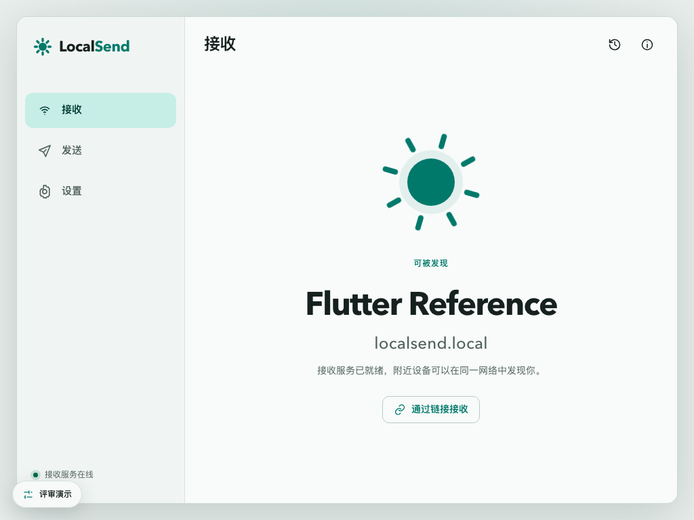
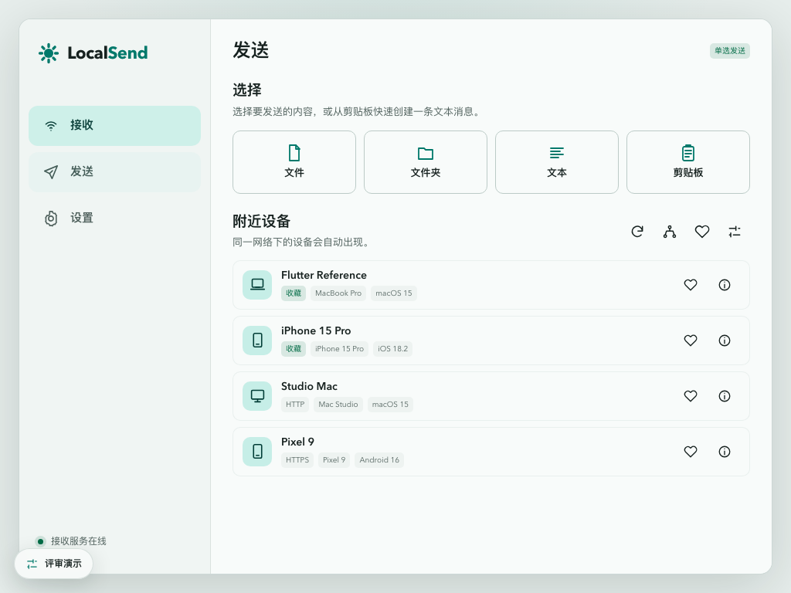
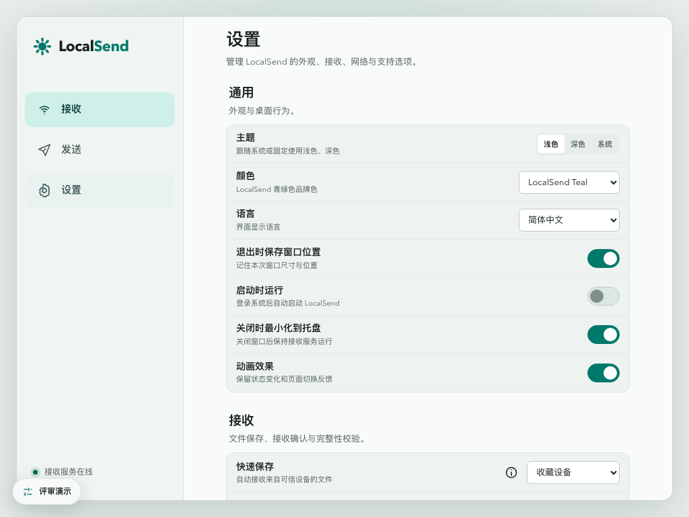

<div align="center">
    

<h1>localsend-next</h1>

[](https://github.com/alkaid-ops/localsend-next/releases)
[](../../LICENSE)
[](https://github.com/alkaid-ops/localsend-next/actions/workflows/release.yml)

</div>

<div align="center">

[English](../../README.md) | [العربية](../../docs/ar/README.md) | [Azərbaycanca](../../docs/az/README.md) | [Беларуская](../../docs/be/README.md) | [Български](../../docs/bg/README.md) | [বাংলা](../../docs/bn/README.md) | [Català](../../docs/ca/README.md) | [Čeština](../../docs/cs/README.md) | [Dansk](../../docs/da/README.md) | [Deutsch](../../docs/de/README.md) | [Ελληνικά](../../docs/el/README.md) | [English (India)](../../docs/en-IN/README.md) | [Español](../../docs/es-ES/README.md) | [Eesti](../../docs/et/README.md) | [Euskara](../../docs/eu/README.md) | [فارسی](../../docs/fa/README.md) | [Suomi](../../docs/fi/README.md) | [Filipino](../../docs/fil-PH/README.md) | [Français](../../docs/fr/README.md) | [Gaeilge](../../docs/ga/README.md) | [Galego](../../docs/gl/README.md) | [ગુજરાતી](../../docs/gu/README.md) | [עברית](../../docs/he/README.md) | [हिन्दी](../../docs/hi/README.md) | [Magyar](../../docs/hu/README.md) | [Հայերեն](../../docs/hy/README.md) | [Bahasa Indonesia](../../docs/id/README.md) | [Italiano](../../docs/it/README.md) | [日本語](../../docs/ja/README.md) | [ខ្មែរ](../../docs/km/README.md) | [한국어](../../docs/ko/README.md) | **Кыргызча** | [ລາວ](../../docs/lo/README.md) | [മലയാളം](../../docs/ml/README.md) | [Монгол](../../docs/mn/README.md) | [Bahasa Melayu](../../docs/ms/README.md) | [नेपाली](../../docs/ne/README.md) | [Nederlands](../../docs/nl/README.md) | [Polski](../../docs/pl/README.md) | [Português (Brasil)](../../docs/pt-BR/README.md) | [Português (Portugal)](../../docs/pt-PT/README.md) | [Română](../../docs/ro/README.md) | [Русский](../../docs/ru/README.md) | [සිංහල](../../docs/si/README.md) | [Slovenčina](../../docs/sk/README.md) | [Slovenščina](../../docs/sl/README.md) | [Српски](../../docs/sr/README.md) | [Српски (ћирилица)](../../docs/sr-Cyrl/README.md) | [Svenska](../../docs/sv/README.md) | [தமிழ்](../../docs/ta/README.md) | [ไทย](../../docs/th/README.md) | [Türkçe](../../docs/tr/README.md) | [Українська](../../docs/uk/README.md) | [اردو](../../docs/ur/README.md) | [Oʻzbekcha](../../docs/uz/README.md) | [Tiếng Việt](../../docs/vi/README.md) | [简体中文](../../docs/zh-CN/README.md) | [繁體中文（香港）](../../docs/zh-HK/README.md) | [繁體中文（台灣）](../../docs/zh-TW/README.md)

</div>


localsend-next - ​​бул Rust менен жазылган LocalSend менен шайкеш иштакта кардары. Ал расмий протоколдо сүйлөйт, ошондуктан ал расмий LocalSend колдонмосу менен файлдарды эки тарапка тең таап, өткөрүп берет, ошол эле учурда Flutter колдонмосунун ордуна түпнуска рабочий программасы катары иштейт.

Тармак тарап расмий LocalSend Rust өзөк болуп саналат, өзгөрүүсүз сатуучу. Анын үстүндөгү бардыгы — демон, RPC катмар, лоток, терминалдык UI жана Slint GUI — ошол өзөктүн айланасында курулган.

## Демо

<picture>
  <source media="(prefers-color-scheme: dark)" srcset="../../docs/images/readme-receive-dark.png">
  
</picture>

| Жөнөтүү | Орнотуулар |
| --- | --- |
|  |  |

## Өзгөчөлүктөрү

- Ачылыш жана өткөрүп берүү LocalSend расмий кардарларына, кайра ишке ашыруунун ордуна сатуучу жогорку агымдагы өзөктө
- Бир канондук штат ээси: демон жөндөөлөрдү, идентификацияны, сүйүктүүлөрдү, тарыхты, которууларды жана TLS идентификациясын сактайт, ошондуктан ар бир фронтон бир эле нерсени көрөт.
- GUI, терминалдык UI жана лоток ошол эле жергиликтүү RPC боюнча көз карандысыз фронттор катары; лоток демонго жана GUI процессине ээлик кылат
- Ар бир файл боюнча реалдуу убакыт прогресси, ачык жана ачык аракеттер менен таржымал, сүйүктүүлөр, түзмөктү кол менен киргизүү жана Web Share алуу шилтемелери
- 57 интерфейс тилдери жогорудагы LocalSend тизмеси менен дал келет, алар иштөө убагында алмаштырылат же системанын тили боюнча
- Түпкү рабочий интеграциясы: лотоктон гана эскертмелер, кирүү учурунда ишке киргизүү, лотокту кичирейтүү, терезени жайгаштыруу туруктуулугу жана анын аталыш тилкесин тарткан macOS терезеси
- macOS (DMG/ZIP), Linux (deb, rpm, AppImage, tarball) жана Windows (ZIP), x86_64 жана aarch64 үчүн таңгактоо

## Архитектура

```text
      Slint GUI · TUI · tray
                │
      localsend-rpc (local socket)
                │
          localsendd (daemon)
                │
   official LocalSend core (vendored)
```

Демон тармак менен сүйлөшкөн же колдонмонун абалын жазган жалгыз процесс. Frontends эч качан сатуучу өзөктөн көз каранды эмес жана эч качан демонду өздөрү чыгарбайт; лоток кылат. Файл байттары RPC аркылуу жүрбөйт — демон жолдорду чечет, мазмунду хэштейт жана тарыхты жазат.

| Бинардык | Роль |
| --- | --- |
| `localsendd` | Тармак кызматы жана канондук колдонмо абалы |
| `localsend-tray` | Daemon жана GUI өмүр циклинин ээси, эскертмелер |
| `localsend-gui-slint` | FemtoVG рендерери менен расмий GUI, Slint |
| `localsend-tui` | Терминалдын алдыңкы бөлүгү |
| `localsend-launcher` | Табагы жок чөйрөлөр үчүн ачык ишке киргизгич |
| `localsend-androidd` | Өз алдынча тамыр үчүн гана Android демонду алуу (MVP) |

`localsend-gui-egui`, `-fltk`, `-iced` жана `-tauri` каталогдору эксперименталдык порттор болуп саналат жана алардын RPC интеграциясы аяктаганга чейин тамыр иш мейкиндигинен тышкары турушат.

## Жүктөп алуу

Чыгарылган активдер бир аталыш схемасына ылайык болот — `LocalSend-<version>-<platform>-<arch>.<ext>`, платформалар `linux` / `windows` / `macos` жана архитектуралар `x86_64` / `aarch64`:

| Платформа | Актив |
| --- | --- |
| macOS | `LocalSend-0.1.3-macos-aarch64.dmg`, `LocalSend-0.1.3-macos-x86_64.dmg` |
| Windows | `LocalSend-0.1.3-windows-x86_64.zip`, `LocalSend-0.1.3-windows-aarch64.zip` |
| Debian / Ubuntu | `LocalSend-0.1.3-linux-x86_64.deb`, `LocalSend-0.1.3-linux-aarch64.deb` |
| Fedora / RHEL | `LocalSend-0.1.3-linux-x86_64.rpm`, `LocalSend-0.1.3-linux-aarch64.rpm` |
| Каалаган Linux | `LocalSend-0.1.3-linux-x86_64.AppImage`, `LocalSend-0.1.3-linux-aarch64.AppImage` |

`SHA256SUMS.txt` релиздеги бардык активдерди камтыйт. CI тарабынан өндүрүлгөн macOS түзмөгүнө Иштеп чыгуучунун идентификаторуна кол коюлган же нотариалдык түрдө эмес, атайын кол коюлган.

## Тез баштоо

### macOS

```bash
open LocalSend-<version>-macos-<arch>.dmg
# drag LocalSend.app into Applications
```

### Debian / Ubuntu

```bash
sudo dpkg -i LocalSend-<version>-linux-<arch>.deb
```

### Fedora / RHEL

```bash
sudo rpm -i LocalSend-<version>-linux-<arch>.rpm
```

### AppImage

```bash
chmod +x LocalSend-<version>-linux-<arch>.AppImage
./LocalSend-<version>-linux-<arch>.AppImage
```

Linux топтомдору демондун жашоо циклине ээ болгон `localsend-tray` ишке киргизген рабочий жазууну орнотот. Статус тилкеси жок столдордо лоток анын ордуна GUI ачык бойдон калат; `LocalSend --launcher` бул режимди ачык түрдө AppImage тандайт.

### Windows

Сызыкты ачып, `LocalSend.exe` иштетиңиз. Архивде GUI, демон, лоток жана ишке киргизгич жанаша турат; аларды бирге сактоо.

## Билүүгө татыктуу жүрүм-турум

- **Чыгуу – бул бир операция.** Тлейден чыгуу акыркы чекитте жазылган `gui.pid` чекитинде жазылган GUI токтотулат, чектелген тайм-ауттун ичинде ээлик кылуучу демонду токтотот жана процессти же ишке киргизилген жандуу ишти калтырбастан чыгат.
- **Эскертмелер лотоктон келет.** GUI эч качан өзүнүн эскертмелерин жарыялабайт, андыктан ар бир платформада бир жеткирүү жолу бар.
- **Терезенин абалы бир акыркы чекитте.** Жайгаштыруу жалпы глобалдык жерде эмес, ошол акыркы чекит үчүн демон конфигурациясынын жанында сакталат, андыктан эки инстанция терезе геометриясын талашпайт.
- **Демон авторитеттүү.** GUI ичинде өзгөртүлгөн орнотуулар демонго тапшырылып, снапшот аркылуу кайра кайталанат; фронтондо дрейф боло турган эч кандай жеке көчүрмө сакталбайт.

## Тилдер

Интерфейс 57 тилде жөнөтүлөт, жогорудагы LocalSend тизмесине туура келет, msgid тили катары жөнөкөйлөштүрүлгөн кытай тили. **Орнотуулар → Тил** астынан бирин тандаңыз же OS тилин колдонуу үчүн аны "Тутумга ээрчүү" дегенге калтырыңыз.

| | |
| --- | --- |
| Топтолгон каталогдор | `apps/localsend-gui-slint/translations/<locale>/LC_MESSAGES/localsend-gui-slint.po` |
| UI булак саптары | `@tr("...")` `apps/localsend-gui-slint/ui` ичинде |
| Англисче каталог | `translations/locale-en.json` (UI), `translations/locale-en-runtime.json` (Rust билдирүүлөр) |
| Дат тараптагы билдирүүлөр | `crates/localsend-i18n` (түзүлгөн `lookup_generated.rs`) |
| Жогорку күзгү | `translations/upstream/<locale>.json` |

Каалаган UI саптарын өзгөрткөндөн кийин каталогдорду калыбына келтириңиз:

```bash
node scripts/update-slint-translations.mjs --collect > /tmp/collect.json
node scripts/translate-slint-locales.mjs    # fills the machine-translation cache
node scripts/update-slint-translations.mjs  # writes the .po files and the Rust table
```

`locale-machine-cache.json` жасалган, ошондуктан түзүлгөн каталогдор оффлайн режиминде кайталанат. Ал жерде жазууну оңдоп, котормону оңдоо үчүн генераторду кайра иштетиңиз.

<details>
<summary>Bundled locales</summary>

`ar` `az` `be` `bg` `bn` `ca` `cs` `da` `de` `el` `en-IN` `en-US` `es-ES` `et` `eu` `fa` `fi` `fil-PH` `fr` `ga` `gl` `gu` `he` `hi` `hu` `hy` `id` `it` `ja` `km` `ko` `ky` `lo` `ml` `mn` `ms` `ne` `nl` `pl` `pt-BR` `pt-PT` `ro` `ru` `si` `sk` `sl` `sr` `sr-Cyrl` `sv` `ta` `th` `tr` `uk` `ur` `uz` `vi` `zh-CN` `zh-HK` `zh-TW`

</details>

## Булактан курулуш

Талаптар: Rust `1.97.1` (кадап койгон `rust-toolchain.toml`) жана Linux түзүмдөрү үчүн, GTK3 жана AppIndicator иштеп чыгуу аталыштары.

```bash
cargo build --release            # workspace binaries
cargo test --locked              # per-crate tests
cargo clippy --all-targets --no-deps -- -D warnings
```

Платформа пакеттери:

```bash
# macOS (on a matching host)
cd apps/localsend-gui-slint && PACKAGE_VERSION=0.1.3 ./package-macos.sh

# Linux
./scripts/package-linux.sh x86_64      # deb + tarball
./scripts/package-rpm.sh x86_64        # rpm
./scripts/package-appimage.sh x86_64   # AppImage

# Windows (PowerShell)
./scripts/package-windows.ps1 -Architecture x64
```

Кабыл алуу скрипттери шылдыңдалган абалдын ордуна чыныгы бинарларды айдайт:

```bash
./scripts/accept-slint.sh   # GUI journeys against a live daemon
./scripts/accept-tui.sh     # terminal frontend
```

## Документация

| Документ | Мазмуну |
| --- | --- |
| [`docs/desktop-pc.md`](../../docs/desktop-pc.md) | Иштөө, таңгактоо жана платформанын жүрүм-туруму |
| [`docs/verification.zh-CN.md`](../../docs/verification.zh-CN.md) | Учурдагы сыноо далилдери жана белгилүү текшерилбеген аймактар |
| [`docs/acceptance-automation.zh-CN.md`](../../docs/acceptance-automation.zh-CN.md) | Жергиликтүү кабыл алуу дарбазалары |
| [`docs/agent-regression-playbook.zh-CN.md`](../../docs/agent-regression-playbook.zh-CN.md) | Кайталануучу регрессиялар жана жүрүм-турумду өзгөртүүгө чейин күтүлгөн далил из |
| [`docs/HANDOFF_CLAUDE.zh-CN.md`](../../docs/HANDOFF_CLAUDE.zh-CN.md) | OpenDesign прототипине каршы визуалдык конвергенция абалы |
| [`docs/android-root-mvp.zh-CN.md`](../../docs/android-root-mvp.zh-CN.md) | Android тамыр модулу жана анын чектери |
| [`VENDORED_CORE.md`](../../VENDORED_CORE.md) | Сатуучу ядронун агымынын жогору чыгышы |

Бул README бардык 57 интерфейс тилдеринде жарыяланган — жогору жактагы которгучтан бирөөсүн тандаңыз. Котормолор `README.md` тарабынан `scripts/translate-readme.mjs` тарабынан түзүлөт; оңдоолор [`docs/i18n-overrides.json`](../../docs/i18n-overrides.json) менен жүргүзүлөт.

Кээ бир документтер кытай тилинде жазылган; алар макулдашылган сөздөр менен текшерүү жүрүштөрүн жана конвенцияларын жазышат.

## Колдонуу чөйрөсү

Негизги продукт PC кардары болуп саналат. Android колдоо бул алкактан тышкары ачык илгерилемейинче, тамыры бар, башсыз кабыл алуу демону — анын GUI жок, алдыңкы пландагы кызматын баштабайт жана туруктуу эскертме жарыялабайт. `crates/localsend-official-core` генерацияланган `SHA256SUMS` файлынан тышкары, байт-байт боюнча анын жазылган жогорудагы экспорту менен бирдей сакталат.

## Кредиттер

Протокол, зым форматы жана Rust өзөгү [localsend/localsend](https://github.com/localsend/localsend); бул долбоор протоколду кайра ишке ашыруунун ордуна ошол иш боюнча иш столунун кардарын курат. LocalSend авторлоруна жана салым кошкондоруна рахмат.

Интерфейс бул долбоор үчүн иштелип чыккан дизайн прототипине ылайык келет; анын визуалдык шилтемеси [`apps/localsend-gui-slint/reference/open-design/`](../../apps/localsend-gui-slint/reference/open-design/) ичинде жашайт.

## салым кошуу

- **Каталар жана сунуштар**: версиясы, платформасы, кайра чыгаруу кадамдары жана көргөн нерселериңиз менен [маселени](https://github.com/alkaid-ops/localsend-next/issues) ачыңыз. Журнал же скриншот аны тезирээк аракетке келтирет.
- **Код**: тартуу өтүнүчтөрү кабыл алынат. daemon/frontend чекине, сатуучу өзөккө же визуалдык келишимге тийген өзгөртүүлөр адегенде талкууланышы керек — чектөөлөр [`AGENTS.md`](../../AGENTS.md) ичинде жазылат.
- **Котормолор**: каталогдор жасалган машина котормо кэшинен түзүлөт, андыктан оңдоолорду карап чыгуу үчүн салымдын эң оңой түрү бар.

## Лицензия

[Apache-2.0](../../LICENSE). Үчүнчү тараптын компоненттери жана алардын лицензиялары [THIRD_PARTY_NOTICES.md](../../THIRD_PARTY_NOTICES.md) дарегинде келтирилген.
